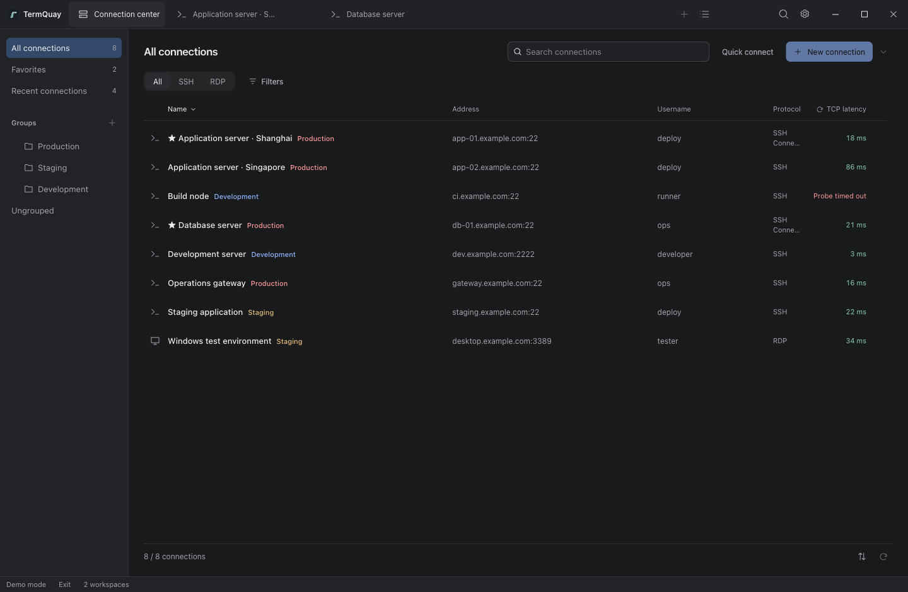
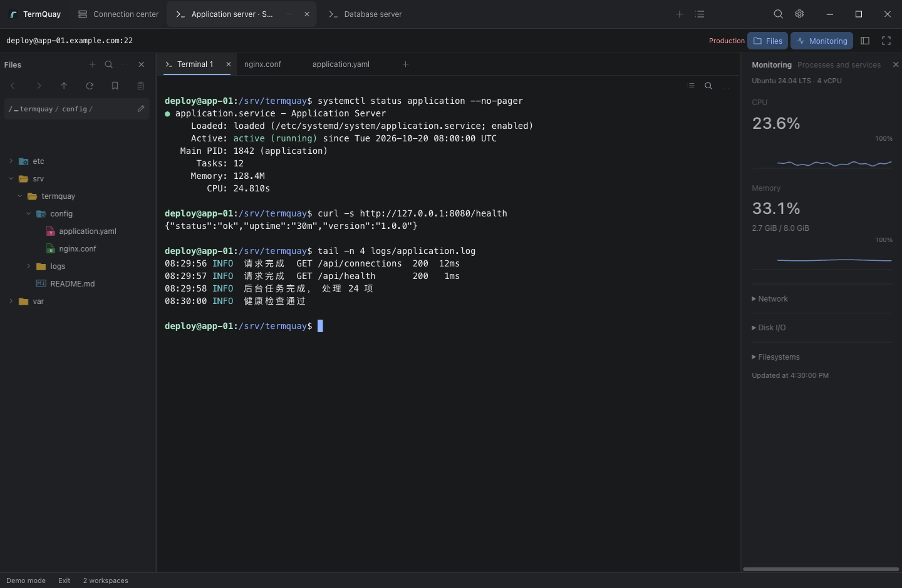
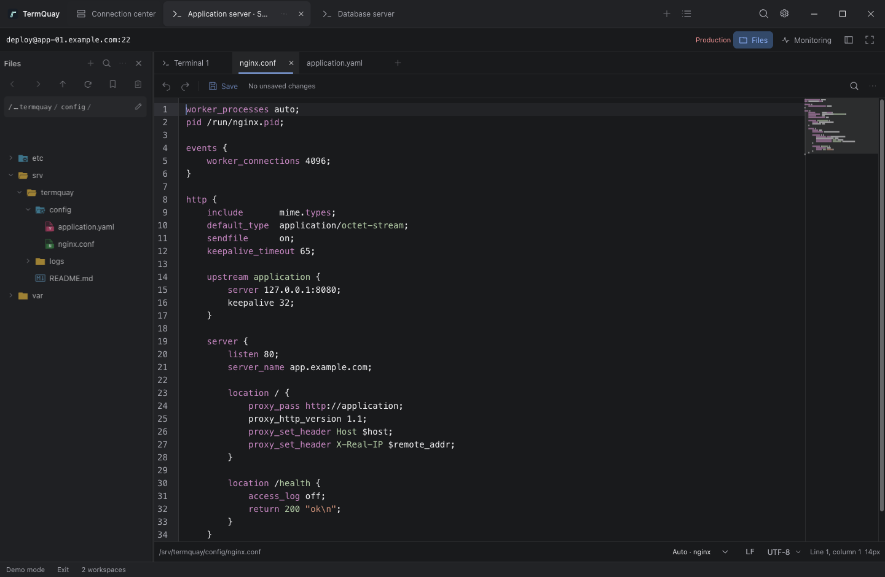

# TermQuay

[简体中文](README.zh-CN.md) · [Contributing](CONTRIBUTING.md)

TermQuay is an open source desktop workbench for SSH, local terminals and RDP. Organize saved connections without a commercial count limit, edit remote files and inspect Linux hosts from the same workspace.

Download the macOS, Windows or Linux archive from [GitHub Releases](https://github.com/Sanjeever/termquay/releases). See the [runtime prerequisites](docs/development.md#packaged-desktop) and [recorded verification limits](docs/development.md#verification-and-known-gaps).

## Interface languages

Choose **Settings → Appearance → Language** to follow the system or select English or Simplified Chinese. Both languages are available offline, including before unlock.

<a id="当前能力"></a>
<a id="comparison-with-other-tools"></a>
<a id="openssh--putty"></a>
<a id="mstsc"></a>
<a id="xshell--securecrt"></a>
<a id="mobaxterm"></a>
<a id="finalshell"></a>
<a id="xterminal--motty"></a>
## Features

- **Connections** — groups, filters, configuration imports, connection playbooks, encrypted credentials and master password protection.
- **[SSH and local terminals](docs/development.md#using-the-workbench)** — multi-pane workspaces, jump hosts, SOCKS5, port forwarding, reconnect and diagnostics.
- **Files and transfers** — a dedicated dual-pane transfer tab for local/remote and cross-host copies, search, batch transfers, explicit resume, directory sync and comparisons.
- **Remote editing** — encodings and line endings, completion, conflict merging, encrypted version history and explicit validation/reload commands. Preview Markdown and common image formats.
- **Terminal tools** — snippets, shell completion, tmux, recording/playback, background multi-host tasks, inspections and result comparisons.
- **Linux diagnostics** — resource trends, processes, systemd services, ports, multi-source logs and diagnostic snapshots.
- **[Docker containers](docs/development.md#docker-containers)** — inspect, open terminals and manage container state over SSH.
- **AI assistant** — workspace conversations, explicit terminal references, capability-based remote queries, command approval and encrypted local history.
- **Remote desktop** — embedded RDP, SSH gateways and the Windows system client.
- **Workspace recovery** — named SSH/RDP working sets, disconnected layouts and encrypted file drafts; appearance and keyboard shortcuts.
- **Encrypted backups** — local files and WebDAV snapshots with previewed recovery and selective configuration migration.

See [usage and boundaries](docs/development.md#using-the-workbench), including the [RDP TLS compatibility boundary](docs/architecture.md#embedded-rdp).

<a id="cli-与-agent-skill"></a>
## CLI and Agent skill

The same executable opens the desktop without arguments and shows CLI usage with `termquay --help`. See the [CLI guide](docs/development.md#local-cli) for access, exact workspace selection and remote command execution.

Install the [TermQuay Agent skill](skills/termquay/SKILL.md):

```sh
npx skills add Sanjeever/termquay --skill termquay -g
```

Omit `-g` for a project installation. Specify `--skill termquay` to avoid installing repository development skills. The skill does not install TermQuay; Node is needed for this installer, not for running the packaged desktop.

<a id="界面预览"></a>
## Screenshots

These screenshots show the English interface in browser demo mode. See [workspace controls](docs/development.md#using-the-workbench) for current layouts and tool placement.







<a id="运行与开发"></a>
## Build and contribute

Follow [first run](docs/development.md#first-run) to install dependencies and start the desktop. See [CONTRIBUTING.md](CONTRIBUTING.md) for the contribution workflow and [development commands](docs/development.md#development-commands) for builds, packaging and checks.

<a id="项目结构与文档"></a>
## Repository map

See [architecture and code navigation](docs/architecture.md) for design contracts, source code and relevant tests. [AGENTS.md](AGENTS.md) defines repository instructions for coding agents.

<a id="开源许可"></a>
## License

[Apache License 2.0](LICENSE). Original dependency licenses are in [build/licenses](build/licenses); provenance, review coverage and distribution gaps are tracked in [THIRD_PARTY_NOTICES.md](THIRD_PARTY_NOTICES.md).
