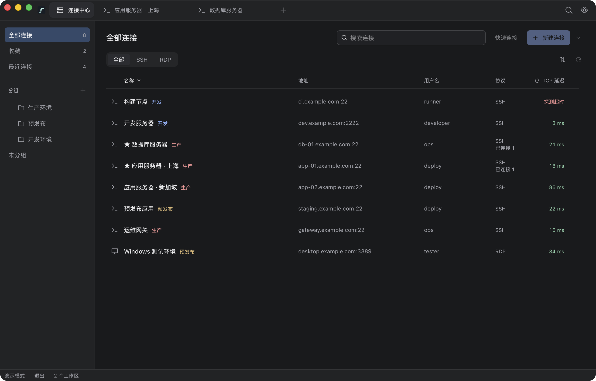
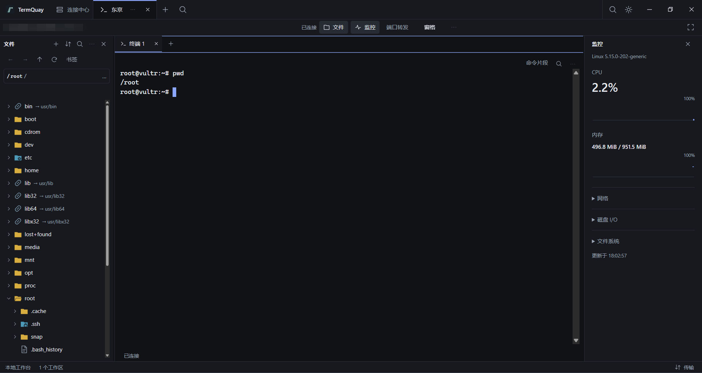
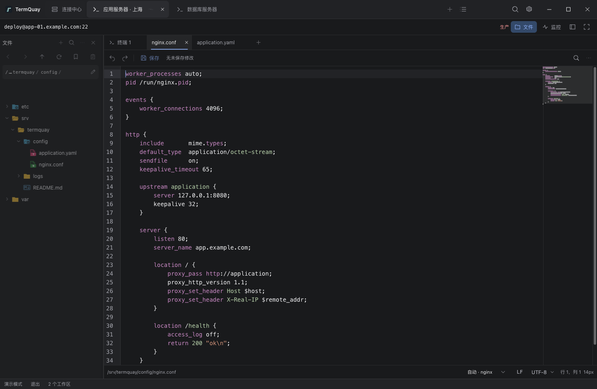

# TermQuay · 栈桥

TermQuay 是使用 Go、Wails v3 和 React 构建的开源远程连接工作台，将 SSH、本地终端、远程文件编辑、Linux 监控和内嵌 RDP 放在统一桌面工作区，支持连接分组与加密 WebDAV 备份。连接数量不设置商业限制。

支持 macOS、Windows 和 Linux。从 [GitHub Releases](https://github.com/Sanjeever/termquay/releases) 下载对应平台的压缩包；运行前提见 [环境说明](docs/development.md#环境与定义入口)，候选包验证与发布流程见 [版本与发布](docs/development.md#版本与发布)。

## 当前能力

- [连接管理](docs/development.md#连接与工作区)：分组、多标签、组合筛选、收藏、最近记录及 OpenSSH / PuTTY 预览导入；连接操作手册关联常用资源，凭据加密保存、显式共享与统一更新，可选主密码保护。
- [SSH 与本地终端](docs/development.md#ssh-工作区与本地终端)：多种认证、用户证书、跳板链、SOCKS5 代理、端口转发与命名服务入口、多工作区与双窗格，以及自动重连和连接诊断。
- [文件管理与传输](docs/development.md#远端文件与传输)：递归搜索、批量传输、文件复制粘贴、本地剪贴板上传、持久存储下跨重启显式续传、单向目录同步、成对浏览、文本对比与跨主机流式复制。
- [文件编辑](docs/development.md#文件编辑)：多编码、高亮与补全、JSON/YAML 诊断、冲突合并、加密版本历史及显式验证/reload；[预览](docs/development.md#文件预览) 支持 Markdown 与常见图片。
- [终端工具](docs/development.md#终端工具与命令片段)：查找、加密片段、会话命令索引、命令完成提醒、POSIX 命令参考与主动启用的 Bash/Zsh 补全、tmux 绑定与显式续接、输出日志、带时间轴录制与离线回放；多主机任务支持后台执行、参数、分批执行、首台确认、巡检判定、文件基线比较、结果对比、加密执行记录与导出。
- [Linux 诊断](docs/development.md#linux-监控与日志查看)：按需监控、趋势、文件系统容量、进程与 systemd 服务、监听端口关联及双来源 TCP 探测；大日志分片跟随与筛选，Docker 容器、Compose 分组、终端、健康与资源诊断及显式启停；手动排障快照支持加密保存、前后比较与分项导出。
- [远程桌面](docs/development.md#远程桌面)：内嵌 RDP、经 SSH 访问内网桌面，以及 Windows 系统客户端入口。
- [本机工作环境](docs/development.md#本地草稿与布局恢复)：命名工作集、工作布局、加密草稿恢复，以及[外观和快捷键设置](docs/development.md#设置与演示模式)。
- [加密备份](docs/development.md#备份与恢复)：本地文件与 WebDAV 快照、设备历史、分项预览恢复、导入连接副本、工作环境配置迁移及自动备份。

操作方式与限制见 [使用说明](docs/development.md#使用说明)，重连修复与本轮验证范围见 [修复及验证缺口](docs/development.md#重连修复与本轮验证缺口)。内嵌 RDP 的 TLS 兼容边界见 [RDP 设计说明](docs/architecture.md#内嵌-rdp)；已记录的原生验证范围与缺口见 [验收记录](docs/development.md#已有验收记录与缺口)，不能据此推断所有目标平台均已验收。

## 界面预览

以下截图在 macOS 原生应用的 [演示模式](docs/development.md#设置与演示模式) 中截取。

连接中心



SSH 工作区



远端文件编辑



## 运行与开发

准备 Go、Node 和 pnpm。工具链及依赖版本以 [go.mod](go.mod)、[frontend/package.json](frontend/package.json) 和锁文件为准，原生桌面还需要对应平台的构建工具与 WebView。

首次运行按 [开发说明](docs/development.md#首次运行) 安装依赖及项目内 Wails CLI，然后在仓库根目录启动：

```sh
wails3 dev
```

平台前提、绑定生成、检查命令和真实服务测试配置见 [开发说明](docs/development.md)，生产构建与安装包入口见 [构建与本地打包](docs/development.md#构建与本地打包)。

## 项目结构与文档

| 入口 | 职责 |
| --- | --- |
| `main.go`、`assets.go` | 程序入口、资源嵌入与构建信息 |
| `internal/app/` | 桌面启动、服务绑定、工作区与跨模块生命周期协调 |
| `internal/` 其余子包 | SSH、远端文件、监控、RDP、存储和备份 |
| `frontend/src/` | React 工作区、终端、编辑器与设置界面 |
| `frontend/bindings/` | 从 Go 生成的前端接口，避免手工维护重复定义 |
| `Taskfile.yml`、`build/` | 开发、原生构建与打包资源 |
| `.github/workflows/`、`scripts/` | 持续集成、版本同步与发布 |
| [架构约束与设计理由](docs/architecture.md) | 设计意图、职责边界、数据与安全契约，附代码定位入口 |
| [开发说明](docs/development.md) | 环境、运行、使用、验证与打包 |
| [Agent 开发约定](AGENTS.md) | 工作边界、事实来源和语义变更后的文档影响分析 |

## 开源许可

项目采用 [Apache License 2.0](LICENSE)。依赖许可原文位于 [build/licenses](build/licenses)，来源、核对范围与发行前待办见 [第三方依赖声明](THIRD_PARTY_NOTICES.md)。
