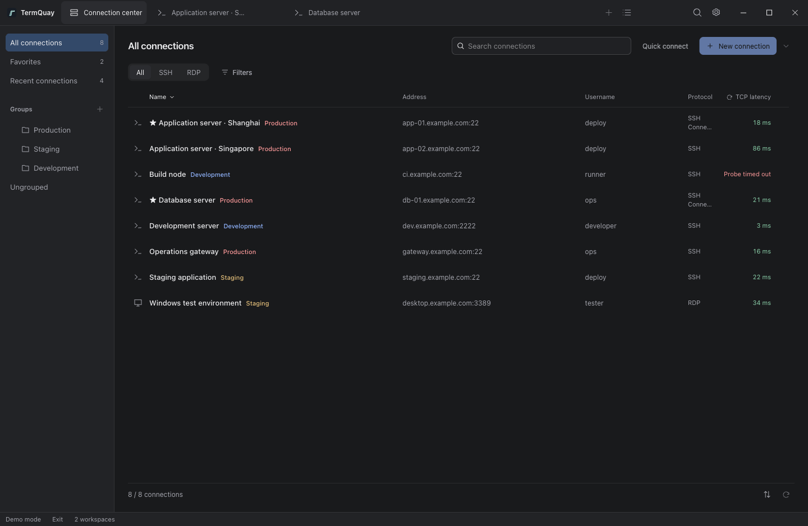
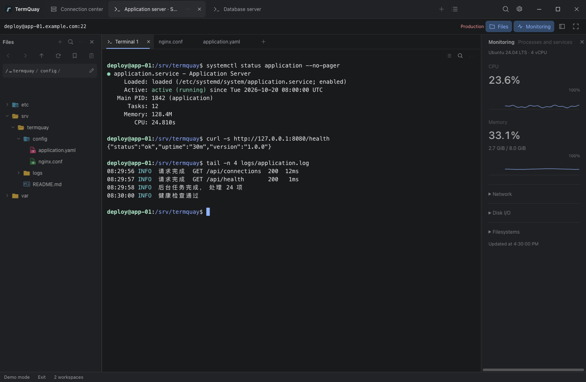
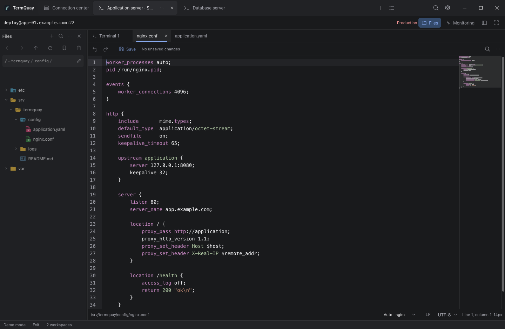

# TermQuay

[简体中文](README.zh-CN.md) · [Contributing](CONTRIBUTING.md)

TermQuay is an open source remote connection workbench built with Go, Wails v3 and React. It brings SSH, local terminals, remote file editing, Linux monitoring and embedded RDP into one desktop workspace. Connections can be grouped and backed up using encrypted local files or WebDAV snapshots. There is no commercial limit on saved connections.

Available for macOS, Windows and Linux. Download the appropriate archive from [GitHub Releases](https://github.com/Sanjeever/termquay/releases). Check [runtime prerequisites](docs/development.md#packaged-desktop) and the [recorded verification limits](docs/development.md#verification-and-known-gaps).

## Interface languages

Choose **Settings → Appearance → Language** to follow the system, use English or use Simplified Chinese. Both languages are bundled for offline use. Language selection is available before unlocking local data. Switching languages preserves open workspaces, connections, transfers and editor drafts.

<a id="当前能力"></a>
<a id="comparison-with-other-tools"></a>
<a id="openssh--putty"></a>
<a id="mstsc"></a>
<a id="xshell--securecrt"></a>
<a id="mobaxterm"></a>
<a id="finalshell"></a>
<a id="xterminal--motty"></a>
## Features

- **Connections** — groups, filters, configuration imports, connection playbooks, encrypted credentials and master password protection.
- **SSH and local terminals** — multiple authentication methods, jump hosts, SOCKS5 proxies, port forwarding, reconnect and connection diagnostics. [Local workspaces](docs/development.md#using-the-workbench) support pane layouts, resizing, drag-to-swap, program status, local editor links and independent renderer settings.
- **Files and transfers** — a dedicated dual-pane transfer tab for local/remote and cross-host copies, search, batch transfers, explicit resume, directory sync and comparisons.
- **Remote editing** — encodings and line endings, completion, conflict merging, encrypted version history and explicit validation/reload commands. Preview Markdown and common image formats.
- **Terminal tools** — snippets, shell completion, tmux, recording/playback, background multi-host tasks, inspections and result comparisons.
- **Linux diagnostics** — resource trends, processes, systemd services, ports, multi-source logs and diagnostic snapshots.
- **Docker containers** — [Tools → Docker](docs/development.md#docker-containers) opens a dedicated tab for container status, resources, logs, terminals, mounts, ports and confirmed start/stop/restart operations over SSH.
- **AI assistant** — workspace conversations, explicit terminal references, capability-based remote queries, command approval and encrypted local history.
- **Remote desktop** — embedded RDP, SSH gateways and the Windows system client.
- **Workspace recovery** — named SSH/RDP working sets, disconnected layouts and encrypted file drafts; appearance and keyboard shortcuts.
- **Encrypted backups** — local files and WebDAV snapshots with previewed recovery and selective configuration migration.

See [usage and boundaries](docs/development.md#using-the-workbench), including the [RDP TLS compatibility boundary](docs/architecture.md#embedded-rdp).

<a id="cli-与-agent-skill"></a>
## CLI and Agent skill

The same executable opens the desktop without arguments. Run `termquay --help` for CLI usage. Enable **Settings → Local CLI** and unlock the desktop before accessing it. Use an exact connected SSH workspace ID for queries or command execution. Commands can modify remote systems; see the [CLI guide](docs/development.md#local-cli).

Install the [TermQuay Agent skill](skills/termquay/SKILL.md):

```sh
npx skills add Sanjeever/termquay --skill termquay -g
```

Omit `-g` for a project installation. Specify `--skill termquay` to avoid installing repository development skills. The skill does not install TermQuay; Node is needed for this installer, not for running the packaged desktop.

<a id="界面预览"></a>
## Screenshots

These screenshots show the English interface in browser [demo mode](docs/development.md#using-the-workbench).







<a id="运行与开发"></a>
## Build and contribute

Start with [CONTRIBUTING.md](CONTRIBUTING.md). English and Chinese contributions are welcome; imperfect English is fine.

Follow [environment and first run](docs/development.md#environment) for toolchain definitions and dependency setup, then run from the repository root:

```sh
pnpm dev
```

The [development commands](docs/development.md#development-commands) cover the project-local Wails CLI, native builds, packaging, bindings and checks. The [architecture guide](docs/architecture.md) explains security, ownership, backpressure and recovery contracts.

<a id="项目结构与文档"></a>
## Repository map

Use the architecture guide's [code navigation](docs/architecture.md#code-navigation) for implementation and verification entry points. [AGENTS.md](AGENTS.md) defines contributor boundaries and documentation synchronization rules.

<a id="开源许可"></a>
## License

[Apache License 2.0](LICENSE). Original dependency licenses are in [build/licenses](build/licenses); provenance, review coverage and distribution gaps are tracked in [THIRD_PARTY_NOTICES.md](THIRD_PARTY_NOTICES.md).
