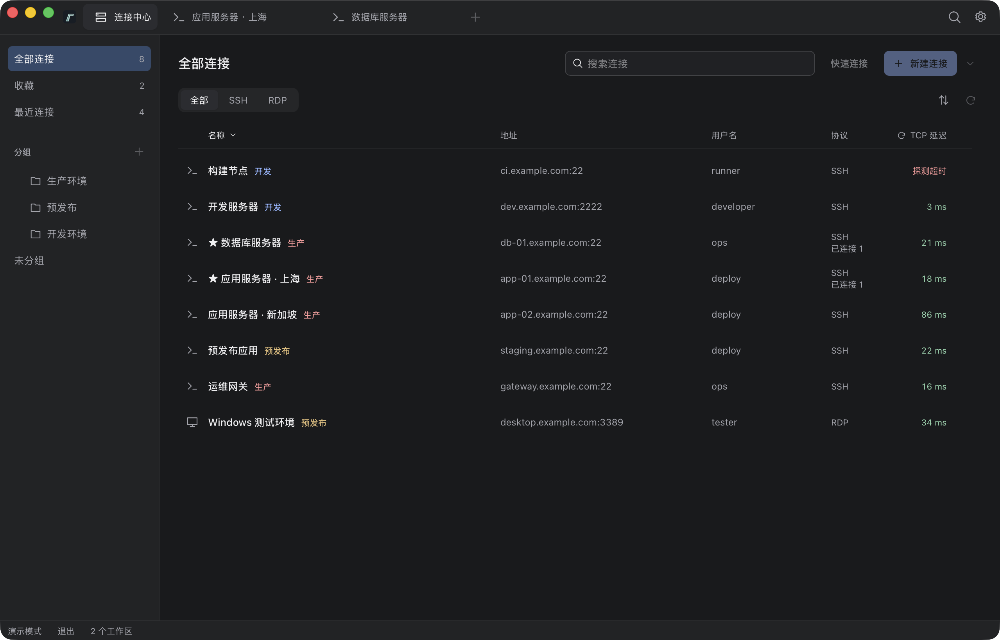
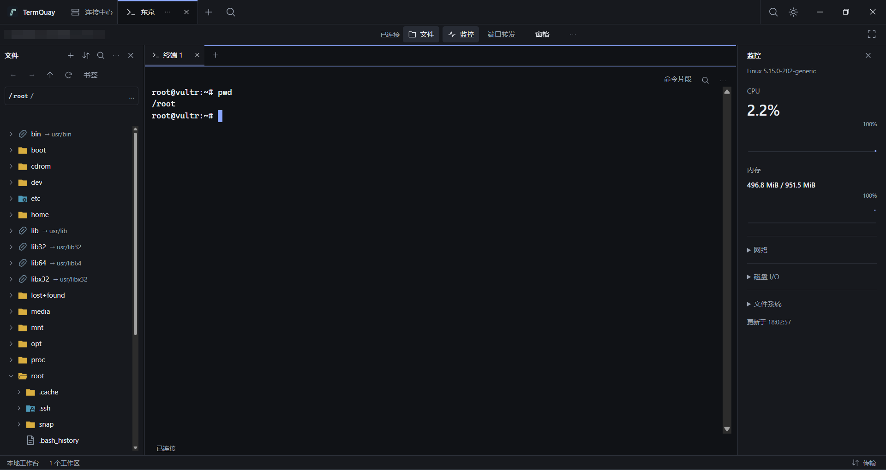
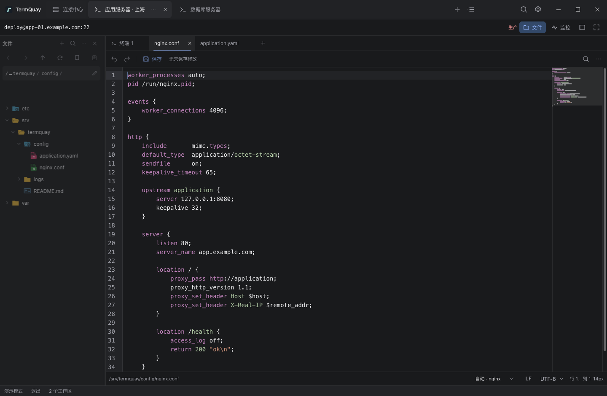

# TermQuay

[English](README.md) · [贡献指南](CONTRIBUTING.md)

TermQuay 是面向 SSH、本地终端和 RDP 的开源桌面工作台。可分组管理连接、编辑远端文件和查看 Linux 主机状态，保存连接数量不设商业限制。

支持 macOS、Windows 和 Linux。从 [GitHub Releases](https://github.com/Sanjeever/termquay/releases) 下载对应平台的压缩包；运行前提见 [发行包运行环境](docs/development.zh-CN.md#发行包运行环境)，已记录的验证范围与缺口见 [验收记录](docs/development.zh-CN.md#已有验收记录与缺口)。

## 界面语言

在“设置 → 外观 → 语言”选择跟随系统、简体中文或 English。两种语言均可离线使用，解锁前也可切换。

## 当前能力

- [连接管理](docs/development.zh-CN.md#连接与工作区)：分组与筛选、配置导入、操作手册、加密凭据与主密码保护。
- [SSH 与本地终端](docs/development.zh-CN.md#ssh-工作区与本地终端)：跳板、SOCKS5、端口转发、重连、诊断和本地多窗格布局。
- [文件管理与传输](docs/development.zh-CN.md#远端文件与传输)：独立双栏传输标签，支持本地与远端、跨主机复制，以及搜索、批量传输、显式续传、目录同步与文件对比。
- [文件编辑](docs/development.zh-CN.md#文件编辑)：多编码、补全、冲突合并、版本历史与配置验证；[文件预览](docs/development.zh-CN.md#文件预览) 支持 Markdown 与常见图片。
- [终端工具与多主机操作](docs/development.zh-CN.md#终端工具与命令片段)：片段与补全、tmux、录制回放、后台执行、巡检与结果比较。
- [Linux 监控与日志](docs/development.zh-CN.md#linux-监控与日志查看)：资源趋势、进程与服务、端口、多来源日志与排障快照。
- [Docker 容器](docs/development.zh-CN.md#docker-containers)：通过 SSH 查看容器、打开终端和管理运行状态。
- [内置 AI 助手](docs/development.zh-CN.md#内置-ai-助手)：SSH 工作区对话、终端选文引用、按远端能力查询与执行脚本、命令批准及本机加密历史。
- [远程桌面](docs/development.zh-CN.md#远程桌面)：内嵌 RDP、SSH 网关与 Windows 系统客户端。
- [工作区恢复](docs/development.zh-CN.md#本地草稿与布局恢复)：SSH/RDP 命名工作集、断开布局与加密文件草稿，以及[外观和快捷键](docs/development.zh-CN.md#设置与演示模式)。
- [加密备份](docs/development.zh-CN.md#备份与恢复)：本地文件与 WebDAV 快照、预览恢复与配置迁移。

操作方式与限制见 [使用说明](docs/development.zh-CN.md#使用说明)，内嵌 RDP 的 TLS 兼容边界见 [RDP 设计说明](docs/architecture.zh-CN.md#内嵌-rdp)。

## CLI 与 Agent Skill

同一程序无参数启动桌面，`termquay --help` 查看 CLI 帮助。访问设置、工作区选择和远端命令用法见 [本机 CLI](docs/development.zh-CN.md#本机-cli)。

[CLI and Agent skill](README.md#cli-and-agent-skill) 提供给外部 Agent 使用的 TermQuay Skill 安装命令。

## 界面预览

以下截图使用中文 UI，在浏览器 [演示模式](docs/development.zh-CN.md#设置与演示模式) 中截取。

## 运行与开发

按 [首次运行](docs/development.zh-CN.md#首次运行) 安装依赖并启动桌面。贡献流程见 [CONTRIBUTING.md](CONTRIBUTING.md)，构建、打包和检查入口见 [开发命令](docs/development.md#development-commands)。

## 项目结构与文档

[架构说明](docs/architecture.zh-CN.md) 记录设计约束和取舍，[代码导航](docs/architecture.md#code-navigation) 指向源码和测试，[AGENTS.md](AGENTS.md) 记录仓库内的 Agent 指令。

## 开源许可

项目采用 [Apache License 2.0](LICENSE)。依赖许可原文位于 [build/licenses](build/licenses)，来源、核对范围与发行前待办见 [第三方依赖声明](THIRD_PARTY_NOTICES.md)。
