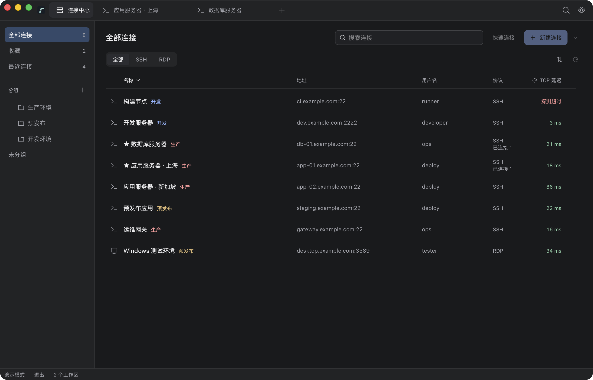
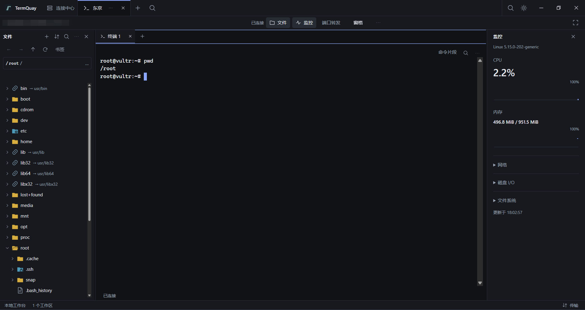
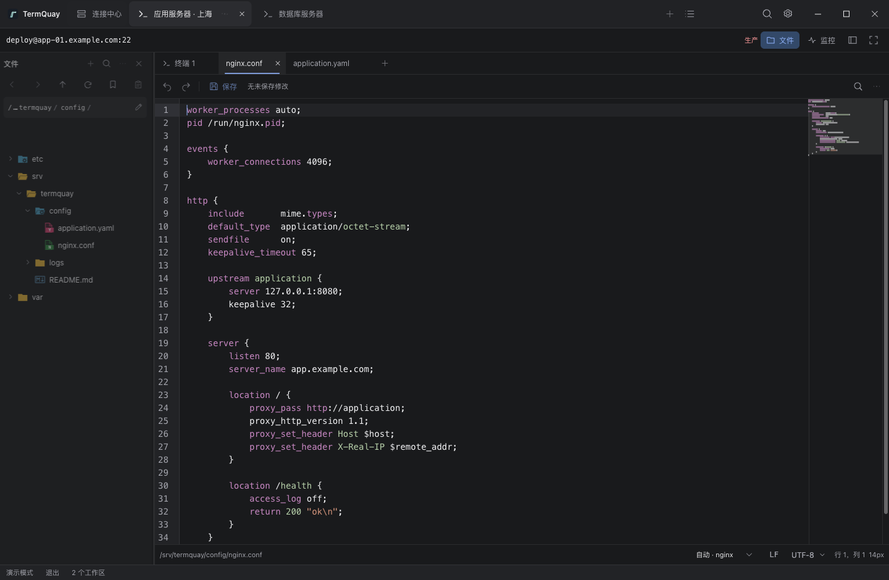

# TermQuay

[English](README.md) · [贡献指南](CONTRIBUTING.md)

TermQuay 是使用 Go、Wails v3 和 React 构建的开源远程连接工作台，将 SSH、本地终端、远程文件编辑、Linux 监控和内嵌 RDP 放在统一桌面工作区，支持连接分组、本地加密文件与 WebDAV 快照备份。连接数量不设置商业限制。

支持 macOS、Windows 和 Linux。从 [GitHub Releases](https://github.com/Sanjeever/termquay/releases) 下载对应平台的压缩包；运行前提见 [发行包运行环境](docs/development.zh-CN.md#发行包运行环境)，已记录的验证范围与缺口见 [验收记录](docs/development.zh-CN.md#已有验收记录与缺口)。

## 界面语言

在“设置 → 外观 → 语言”选择跟随系统、简体中文或 English。语言资源随应用离线分发，解锁本机数据前即可生效。切换语言保留活动工作区、连接、传输与编辑草稿。

## 当前能力

- [连接管理](docs/development.zh-CN.md#连接与工作区)：分组与筛选、配置导入、操作手册、加密凭据与主密码保护。
- [SSH 与本地终端](docs/development.zh-CN.md#ssh-工作区与本地终端)：多种认证、跳板与代理、端口转发、双窗格、重连与连接诊断。
- [文件管理与传输](docs/development.zh-CN.md#远端文件与传输)：搜索、批量传输、显式续传、目录同步、文件对比与跨主机复制。
- [文件编辑](docs/development.zh-CN.md#文件编辑)：多编码、补全、冲突合并、版本历史与配置验证；[文件预览](docs/development.zh-CN.md#文件预览) 支持 Markdown 与常见图片。
- [终端工具与多主机操作](docs/development.zh-CN.md#终端工具与命令片段)：片段与补全、tmux、录制回放、后台执行、巡检与结果比较。
- [Linux 监控与日志](docs/development.zh-CN.md#linux-监控与日志查看)：资源趋势、进程与服务、端口、多来源日志与排障快照。
- [Docker 容器](docs/development.zh-CN.md#docker-containers)：“工具 → Docker”打开独立标签，通过 SSH 查看容器状态、资源、日志、终端、挂载和端口，确认后启动、停止或重启。
- [内置 AI 助手](docs/development.zh-CN.md#内置-ai-助手)：SSH 工作区对话、终端选文引用、按远端能力查询与执行脚本、命令批准及本机加密历史。
- [远程桌面](docs/development.zh-CN.md#远程桌面)：内嵌 RDP、SSH 网关与 Windows 系统客户端。
- [本机工作环境](docs/development.zh-CN.md#本地草稿与布局恢复)：命名工作集、布局与草稿恢复，以及[外观和快捷键](docs/development.zh-CN.md#设置与演示模式)。
- [加密备份](docs/development.zh-CN.md#备份与恢复)：本地文件与 WebDAV 快照、预览恢复与配置迁移。

操作方式与限制见 [使用说明](docs/development.zh-CN.md#使用说明)，内嵌 RDP 的 TLS 兼容边界见 [RDP 设计说明](docs/architecture.zh-CN.md#内嵌-rdp)。

## 对比其他工具

TermQuay 面向多主机日常管理，将配置编辑、日志排查、任务结果比较和远程桌面放在统一桌面工作区。

### OpenSSH / PuTTY

[OpenSSH](https://www.openssh.org/) 提供 SSH、文件传输和隧道命令行工具；[PuTTY](https://www.chiark.greenend.org.uk/~sgtatham/putty/) 通过 SSH 等协议提供终端访问。TermQuay 将连接分组、终端分屏、图形化文件管理、远程编辑和监控整合到同一工作区，通过命名工作集、布局与草稿恢复，方便继续之前的工作。

### MSTSC

[MSTSC（Microsoft Terminal Services Client）](https://learn.microsoft.com/en-us/windows-server/administration/windows-commands/mstsc) 是 Windows 远程桌面连接客户端。TermQuay 在同一连接目录中管理 SSH 与 RDP，通过内嵌桌面和 SSH 网关处理 Linux 与 Windows 混合环境。在 Windows 上，也可以从已保存的 RDP 连接启动系统客户端。

### Xshell / SecureCRT

[Xshell](https://www.netsarang.com/en/xshell/) 和 [SecureCRT](https://www.vandyke.com/products/securecrt/index.html) 提供终端会话、会话管理与脚本工具。TermQuay 采用 Apache-2.0 开源许可，在终端之外整合远程编辑、Linux 诊断、多来源日志与加密备份。源码可供检查和定制，已保存连接数量不设置商业限制。

### MobaXterm

[MobaXterm](https://mobaxterm.mobatek.net/) 在 Windows 上整合终端、X Server 与远程连接工具。[Home Edition](https://mobaxterm.mobatek.net/download.html) 对会话和 SSH 隧道数量设有限制，Professional Edition 取消这些限制。TermQuay 在 macOS、Windows 和 Linux 上提供一致的工作台界面，已保存连接数量不设置商业限制，并通过加密备份在设备间迁移连接配置。

### FinalShell

[FinalShell](https://www.hostbuf.com/t/988.html) 整合 SSH、文件管理、监控与远程桌面。TermQuay 注重配置编辑流程，支持处理编辑冲突、从加密版本历史恢复草稿，以及显式执行配置验证、重载与健康检查。本地加密备份和自选 WebDAV 存储中的快照支持恢复预览与选择性导入连接。

### XTerminal / motty

[XTerminal](https://docs.xterminal.cn/) 和 [motty](https://github.com/t8y2/motty) 同样整合 SSH、SFTP、远程桌面与 AI；motty 采用 Apache-2.0 开源许可和原生界面。TermQuay 通过独立工具标签组织后台多主机任务、结果比较、多来源日志与 Docker 操作，复用已有 SSH 连接。[本机 CLI 与 Agent Skill](#cli-与-agent-skill) 让外部 Agent 在明确选定的已连接 SSH 工作区查询信息和执行命令。

## CLI 与 Agent Skill

同一程序无参数启动桌面，`termquay --help` 查看 CLI 帮助。先在桌面“设置 → 本机 CLI”启用访问并解锁，再用精确 SSH 工作区 ID 查询远端或执行命令。CLI 可修改远端，支持命令、平台程序路径与取消限制见 [本机 CLI](docs/development.zh-CN.md#本机-cli)。

安装供外部 AI Agent 使用的 [termquay skill](skills/termquay/SKILL.md)：

```sh
npx skills add Sanjeever/termquay --skill termquay -g
```

项目级安装去掉 `-g`。指定 `--skill termquay`，避免同时安装仓库开发技能。Skill 不安装 TermQuay；Node 仅供 skill 安装使用。

## 界面预览

以下截图使用中文 UI，在浏览器 [演示模式](docs/development.zh-CN.md#设置与演示模式) 中截取。

连接中心



SSH 工作区



远端文件编辑



## 运行与开发

准备 Go、Node 和 pnpm。工具链及依赖版本以 [go.mod](go.mod)、[frontend/package.json](frontend/package.json) 和锁文件为准，原生桌面还需要对应平台的构建工具与 WebView。

首次运行按 [开发说明](docs/development.zh-CN.md#首次运行) 准备依赖，然后在仓库根目录启动：

```sh
pnpm dev
```

项目内 Wails CLI、构建、打包、绑定生成和检查入口统一见 [开发命令](docs/development.md#development-commands)，平台前提与真实服务测试配置见 [开发说明](docs/development.zh-CN.md)。

## 项目结构与文档

实现与验证入口统一见架构文档的 [代码导航](docs/architecture.md#code-navigation)。[架构说明](docs/architecture.zh-CN.md) 保留设计前提与取舍，[开发说明](docs/development.zh-CN.md) 提供运行、使用和验证入口，[AGENTS.md](AGENTS.md) 规定贡献边界与文档同步要求。

## 开源许可

项目采用 [Apache License 2.0](LICENSE)。依赖许可原文位于 [build/licenses](build/licenses)，来源、核对范围与发行前待办见 [第三方依赖声明](THIRD_PARTY_NOTICES.md)。
